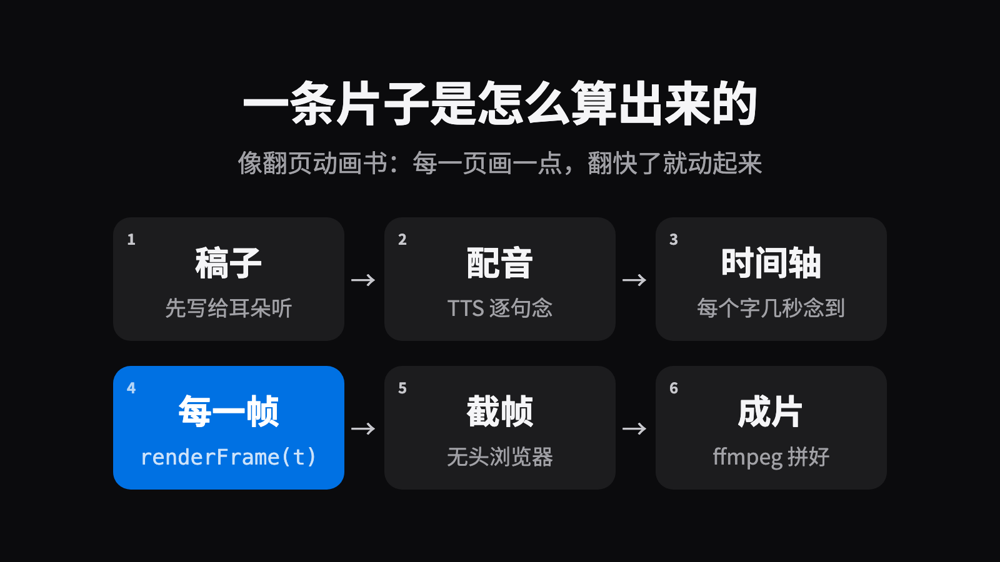
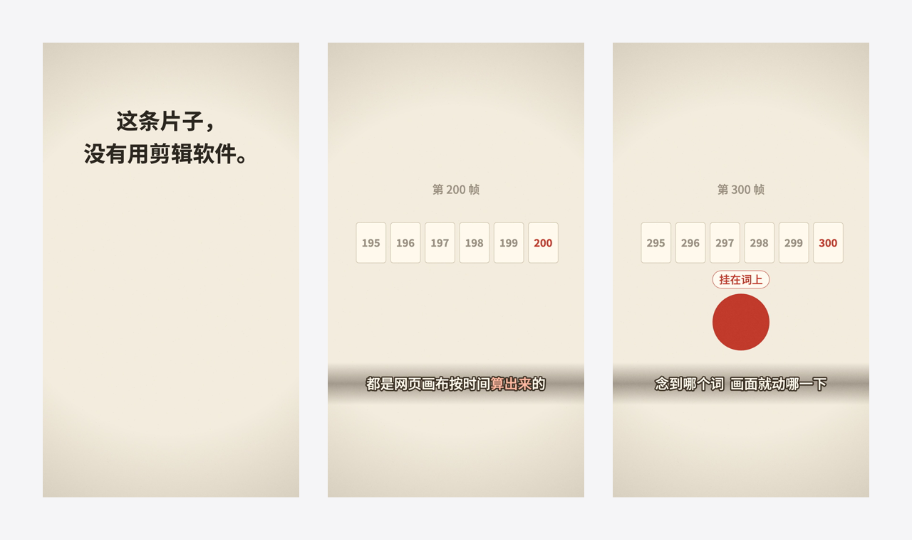

# video-playbook：不用剪辑软件，用代码做短视频


刷到一条讲解短视频，你多半会以为：有人坐在剪辑软件前，拖素材、拉时间线、一句句对字幕。

这个仓库里的片子，没有一条是这么做的。画面是网页上的代码按时间**一帧一帧算出来的**，再交给浏览器截图、ffmpeg 拼成片。配音、配乐、音效、检查也都接在这条流水线上。

下面讲它怎么做到，以及做了二十来条竖屏片子之后，留下了哪些原则、做法和案例。

## 这是什么，适合谁

- **一份手册**：从选题、写稿、画面、声音、审稿到发布，每一步的规矩和为什么。
- **一套能跑的代码**：画面底座、逐帧渲染、自动检查、合成音效、混音，加一条 15 秒的示例片。
- 各文件夹里说的「车间」，就是作者做这些片子的工作台。
- **适合**：想用代码做讲解类短视频的人，以及帮人做视频的 AI 助手（规矩写得够细，助手照着就能干活）。

## 先读什么

1. [`原则.md`](原则.md)：八句方向，每次开工先读，两分钟。
2. 跑一遍示例片（见下面「5 分钟跑起来」）。
3. 干到哪一步，打开 [`方法/README.md`](方法/README.md) 的总表，点进那一步的文件。
4. [`案例本/`](案例本/README.md) 不用先读：碰到索引里「什么时候翻」写的情形，再去查那一条。

## 一条片子是怎么算出来的



- **像翻页动画书。** 每一页画一点点，翻快了就动起来。这里每一页由一个函数 `renderFrame(t)` 画：给它一个时刻 t，它算出这一刻画面上该有什么。
- **像卡拉 OK 的歌词。** 唱到哪个字，哪个字就亮。片子里的动作挂在「词」上：念到「算出来」，红圈就升起来。换了配音，时间轴重算，画面自己跟着走。
- **好处是能检查。** 每一帧都是算出来的，所以渲染之前，机器就能把全片过一遍：字太小、字压字、字被手机上的点赞按钮挡住、画面停太久。改一处，只重渲那 10 秒。

## 从一个念头到一条片子


动手之前先过「选题门」：有没有一大群人本来就关心这个题。题不对，做得再好也没人看。


写的人自己读，总觉得哪句都清楚。所以请没看过背景的审稿人来审两道：配音前听稿子，成片后看画面。细节在 [`方法/`](方法/)。

## 形式怎么挑


同一个内容，可以是「一个问题往下追」配「像素游戏」，也可以是「一条时间线」配「水墨留白」。做过的组合和各自的坑在 [`形式库/`](形式库/)。

## 5 分钟跑起来



上面是示例片 `示例-一帧一帧` 里的三帧。要在自己的电脑上跑出来（在 Apple Silicon Mac 上验证过）：

```zsh
git clone https://github.com/jinjiel1994/video-playbook.git
cd video-playbook/代码
npm install                       # 只装 playwright-core，用来驱动浏览器
cp local.env.example local.env    # 浏览器、Python 放在哪，按自己的机器改
cd 片子/示例-一帧一帧
./跑一遍.sh                        # 估时间轴 → 检查 → 渲染 → 混音 → 出片
```

要先装好 Node、ffmpeg、带 numpy 和 scipy 的 Python、Noto Sans CJK SC 字体。成片在 `build/out/` 里。示例片不配音（按字数估时间轴），只有合成的垫底和音效，所以不用任何 key。完整说明见 [`代码/README.md`](代码/README.md)。

## 仓库地图

| 去哪 | 看什么 |
|---|---|
| [`原则.md`](原则.md) | 八句方向，每次开工先读 |
| [`方法/`](方法/) | 从选题到出片的每一步：规矩和为什么 |
| [`形式库/`](形式库/) | 结构、画法、美学手法：做过什么、什么时候用 |
| [`案例本/`](案例本/README.md) | 以前的坑和改法、每条片子的复盘、别人的好片子拆解；碰到类似情形再翻 |
| [`规格/`](规格/) | 抖音、视频号的界面区、第一帧、封面，各种片长 |
| [`代码/`](代码/) | 能跑的工具、模板和示例片 |

## 这里没有的

配音、回读、生成配乐要接云端服务（要 key）或几个 G 的模型，这部分没放进来；[`方法/声音.md`](方法/声音.md) 写了做法，可以自己接一个 TTS。片子本身、声音、字体文件也不在仓库里。

## 授权

- 文字（`代码/` 以外的全部文件）：[CC BY 4.0](https://creativecommons.org/licenses/by/4.0/)，见 [`LICENSE-docs`](LICENSE-docs)。转载、改编、商用都可以，署名 Jinjie Li 并注明出处。
- 代码（`代码/` 下的全部文件）：MIT，见 [`LICENSE`](LICENSE)。
- 第三方的东西（playwright-core、Noto 字体、CMU 动作数据）各按各的授权，写在 `LICENSE` 开头。
